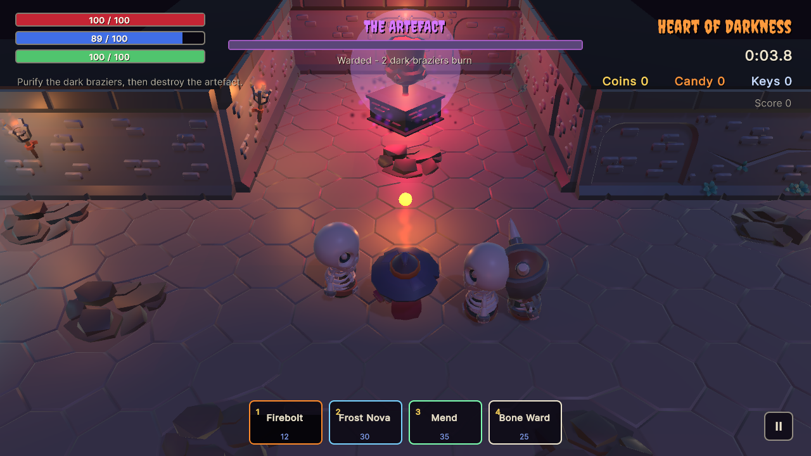
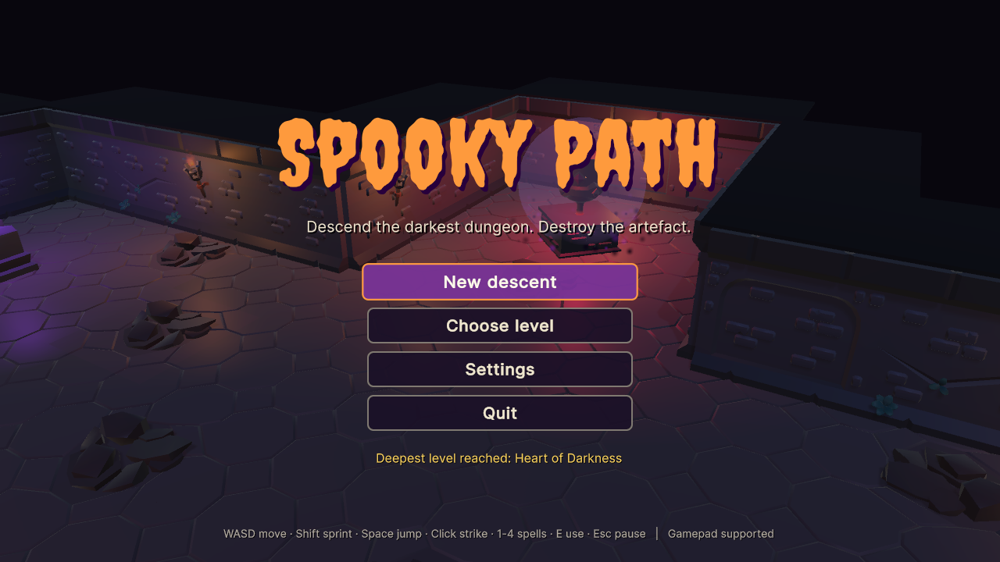
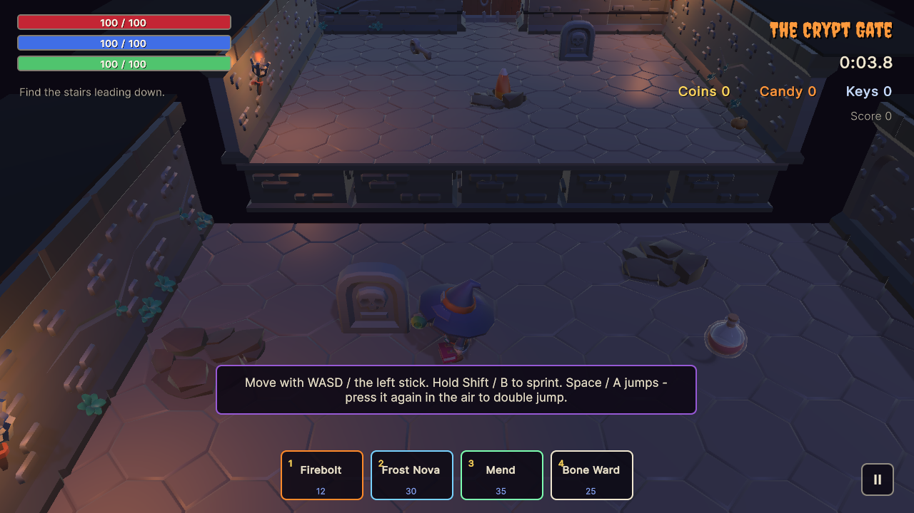
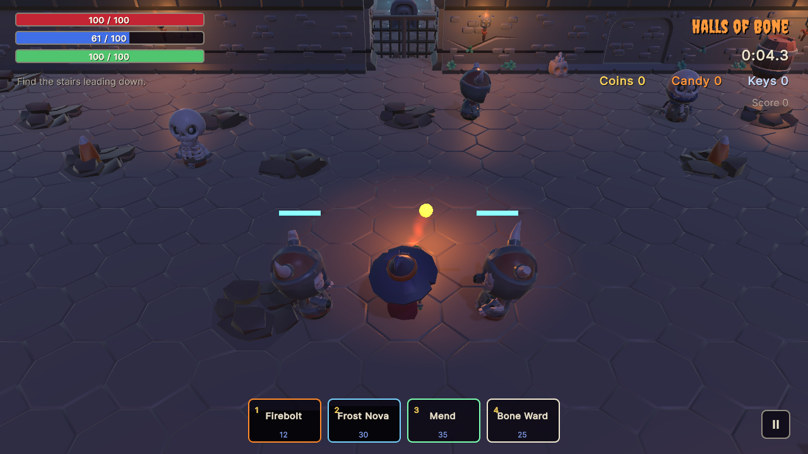
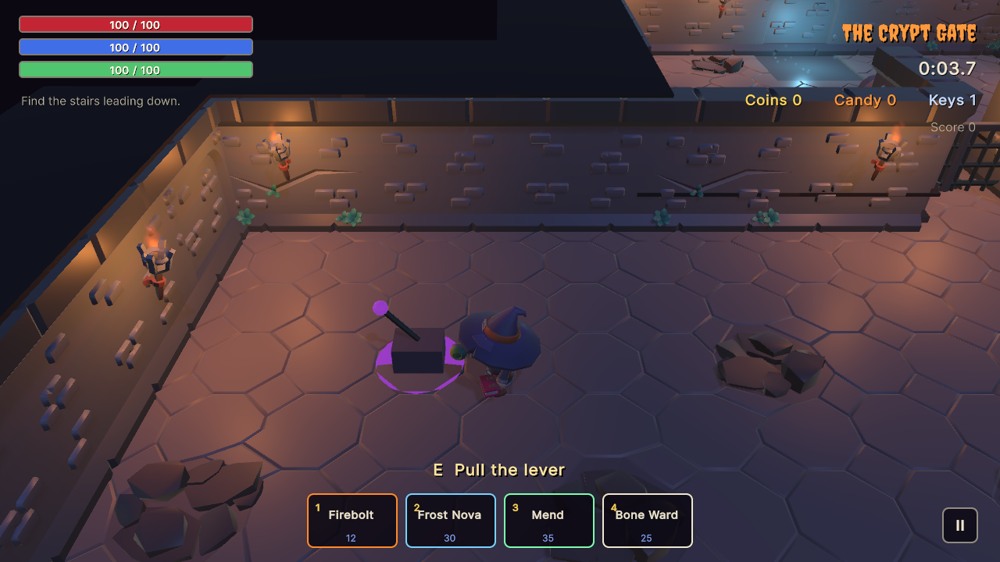
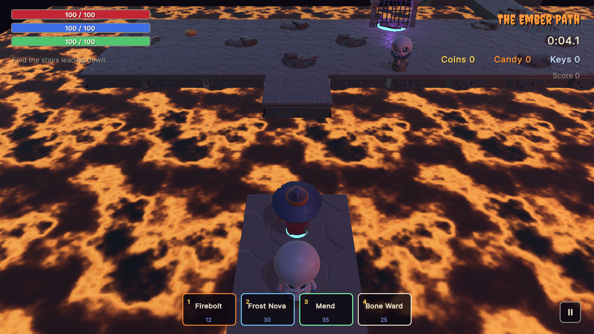
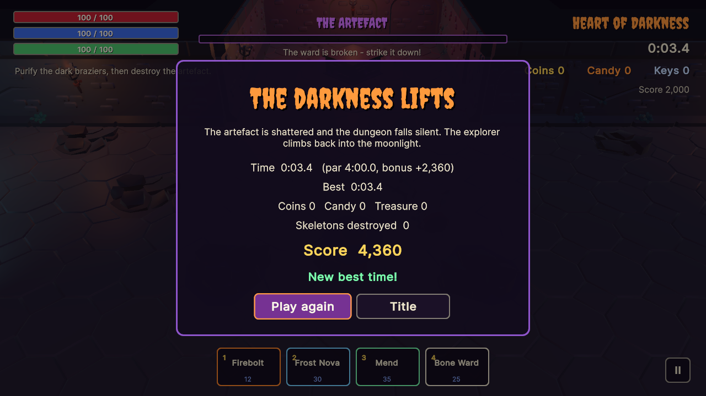

# Spooky Path

A 3D dungeon action-adventure made with Unity: an explorer descends through a tutorial and
three levels of crypts, bone halls and paths over lava to destroy the artefact that spreads
darkness from the bottom of the dungeon, fighting skeletons with a staff and four spells and
solving locks, levers and pressure plates on the way.



| | |
|---|---|
|  |  |
|  |  |
|  |  |

## Play it

- **In your browser:** [trysac.github.io/Spooky_path](https://trysac.github.io/Spooky_path/)
  (published from the GitHub Actions workflow).
- **On itch.io:** [trysac.itch.io/spooky-path](https://trysac.itch.io/spooky-path)
- **Get the code:** fork this repository, or clone it:

  ```bash
  git clone https://github.com/Trysac/Spooky_path.git
  ```

## Run it

1. Install **Unity 6000.3.27f1 (Unity 6 LTS)** with Unity Hub (add the Windows or Web build
   support module if you want to build players).
2. In Unity Hub choose **Add → Add project from disk** and select the repository folder.
3. Open `Assets/Scenes/Game.unity` and press **Play**.

To build a player use **File → Build Profiles** (Windows or Web), or build from a terminal into
a folder outside the repository:

```bash
Unity -batchmode -quit -projectPath . -executeMethod SpookyPath.EditorTools.ProjectBuilder.BuildWebGL -buildOutput ../build/web
```

(`BuildWindows` works the same way.) The WebGL build is uncompressed, so it runs from any
static host such as GitHub Pages; its canvas is 1280×720.

The tests run from **Window → General → Test Runner** (EditMode and PlayMode), or from a terminal:

```bash
Unity -batchmode -projectPath . -runTests -testPlatform EditMode -testResults editmode.xml
Unity -batchmode -projectPath . -runTests -testPlatform PlayMode -testResults playmode.xml
```

Generated content can be rebuilt from text: **Spooky Path → Regenerate Project** (or
`-executeMethod SpookyPath.EditorTools.ProjectBuilder.SetUpProject`) recreates the materials,
lava texture, animator, art asset, icon, scene and player settings, and
`python tools/audio/build.py` (needs ffmpeg) re-synthesizes every sound.

The README screenshots come from an opt-in hook: run a built player with
`-screenshot <folder>` (optionally
`-scenario title,tutorial,combat,puzzle,lava,artefact,pause,gameover,victory`), or, without a
player,
`Unity -batchmode -projectPath . -executeMethod SpookyPath.EditorTools.ProjectBuilder.CaptureScreenshots -screenshot <folder>`.

## Controls

| Action | Keyboard and mouse | Gamepad |
|---|---|---|
| Move | WASD or arrow keys | Left stick or d-pad |
| Sprint (uses stamina) | Shift | B (hold) or left stick click |
| Jump / double jump | Space (press again in the air) | A |
| Staff strike | Left click or J | X |
| Firebolt / Frost Nova / Mend / Bone Ward | 1 / 2 / 3 / 4 (right click also casts Firebolt) | LB / RB / LT / RT |
| Pull a lever, purify a brazier | E | Y |
| Pause | Esc or P | Start |
| Menus | Mouse, or W/S + Enter, Esc to go back | D-pad + A, B to go back |

## How it plays

- **The descent.** Four levels, each unlocked by finishing the one before:

  | Level | What it asks of you |
  |---|---|
  | The Crypt Gate | Tutorial: signs explain moving, jumping a pit, keys, fighting and levers |
  | Halls of Bone | Patrolling skeletons, two pressure plates that open the gate, a key for the treasury |
  | The Ember Path | Narrow paths over lava, moving platforms, teleport stones, spike traps, skeleton mages |
  | Heart of Darkness | Purify three dark braziers to break the artefact's ward, then destroy it while it raises skeletons |

- **The explorer** has health, mana and stamina. Sprinting drains stamina; when it runs out
  you cannot sprint again until a quarter has come back. Mana refills slowly. Potions restore
  health, mana or stamina only when you need them; the rare elixir raises all three limits.
- **Spells.** Firebolt (12 mana) flies at the nearest skeleton in front of you; Frost Nova
  (30) damages and slows everything around you; Mend (35) heals; Bone Ward (25) blocks all
  damage for 4 seconds. Each has a cooldown shown on its slot. The staff strike is free.
- **Skeletons** see you only with a clear line of sight within their range, chase you, wind up
  before each blow (step back to dodge it), give up after losing you for 3 seconds and walk
  back to their post. Minions are quick, warriors are armoured and hit hard, mages keep their
  distance and throw cursed bolts. Hurting one always alerts it.
- **Hazards.** Lava and pits are fatal; spike traps rattle before they rise.
- **Score and saving.** Coins, candy, treasure chests, destroyed skeletons and the artefact
  give points; every second under the level's par time adds a bonus at the end. The game
  saves unlocked levels, the best time and score of each level, and the volume settings
  (PlayerPrefs, so in the browser it is per device).

## What I learned / technically interesting

- **Rules without the engine.** The explorer's health, mana and stamina, the spells, the
  strike arc, the skeletons' perception and state machine, the text-map levels, levers,
  plates, gates, keys and doors, the warded artefact, scoring and the save format live in
  `Assets/Scripts/Core`, a plain C# assembly with no Unity references, covered by 73 EditMode
  tests. The Unity layer builds the levels, moves bodies, plays effects and reads input; 17
  PlayMode tests drive the real scene through menus, puzzles, deaths and the ending.
- **Levels as text.** Each level is a small ASCII map (`Assets/Scripts/Core/Levels.cs`): one
  character per 4 m cell for walls, lava, pits, enemies, pickups, puzzles, teleporters and
  platform tracks. The parser validates it (one start, keys for every door, a switch for every
  gate, straight platform tracks, paired teleporters) and a reachability search proves every
  item and the exit can be reached, jumping one-cell gaps and riding platforms.
- **A bug the tests caught.** The 2023 sprint drained `Mathf.RoundToInt(drain * deltaTime)`
  stamina per frame, so the rate depended on the frame rate (double speed at 60 fps, nothing
  above it). The extracted rule failed its test (expected 70, was 40) before the fix.
- **Unrigged characters, animated anyway.** The KayKit skeletons are separate meshes without
  bones, so walking, winding up, striking and staggering are procedural (arm swings around a
  shoulder pivot, bobbing, lunges), and on death the model is swapped for its "broken" variant
  whose pieces become rigid bodies.
- **Readable 3D from above.** Walls only appear where they face a walkable cell, and the ones
  between the camera and the explorer are kept low, so the hero is never hidden.
- **Everything else is generated.** Materials, the lava texture (tileable fractal noise), the
  explorer's animator, the scene, the icon and the player settings come from an editor script
  (`ProjectBuilder.cs`); particle effects are built in code; the music and sound effects come
  from a small Python synthesizer (`tools/audio`). The UI is UI Toolkit and input goes through
  the Input System, so mouse, keyboard and gamepad all work, menus included.
- **Rescuing old work.** This began in November and December 2023 as a group-project
  prototype in Unity 2021.3: scenes assembled by hand from KayKit tiles, Asset Store effects,
  fonts and UI packs, and a Level 1 left half-finished. It was upgraded to Unity 6, the
  material that could not be redistributed was removed, the rules were extracted and tested,
  and the idea was finished: puzzles, a real ending, pause, settings, saved best times and
  gamepad support.

## Credits

3D models: KayKit packs by Kay Lousberg (CC0). Font: Creepster by Font Diner (SIL Open Font
License). Everything else (code, generated materials and textures, icon, effects, music and
sound) was made for this project. See [CREDITS.md](CREDITS.md).

## License

Code: [MIT](LICENSE). The KayKit models are CC0 and the Creepster font is under the SIL Open
Font License 1.1 (`Assets/UI/Fonts/OFL.txt`).
